# java-applicazioni

[](https://github.com/alessandromari81-creator/java-applicazioni/actions/workflows/test.yml)

**Sviluppato con il supporto di Claude (sviluppo assistito da AI).**

Raccolta di applicazioni Java di Alessandro. Oggi contiene una sola applicazione:

| Cartella | Cosa è |
|---|---|
| [`palestra/`](palestra/) | **Gestione Palestra**: pannello di controllo web + API REST per corsi, utenti (admin, istruttori, iscritti) e abbonamenti |

## Gestione Palestra

**Stack:** Java 21 (Temurin) · Spring Boot 4.1 · Maven · Thymeleaf · Spring Security (sessione per il pannello, JWT per la API) · JPA/Hibernate · PostgreSQL 17 (Docker) + Flyway · Swagger/OpenAPI (springdoc) · JUnit + MockMvc.

**Cosa fa**
- Pannello di amministrazione (ruolo ADMIN): CRUD di corsi, utenti e abbonamenti, con liste paginate, ordinabili e con ricerca.
- **Area personale** per iscritti e istruttori: ognuno vede i propri dati (profilo, corsi, abbonamenti); l'istruttore vede gli iscritti ai propri corsi (solo nome e cognome).
- **Registrazione libera con conferma via email**, «password dimenticata» e invito dell'amministratore, con link monouso e a tempo. Le email **non partono dentro la richiesta**: finiscono in una coda (tabella `email_in_coda`) e un compito programmato le spedisce entro pochi secondi, riprovando con attese crescenti se il server di posta non risponde (in sviluppo le email si leggono in Mailpit).
- Istruttori (uno-a-molti verso i corsi) e iscritti (molti-a-molti), con regole di business (es. un istruttore non può iscriversi al proprio corso; abbonamenti senza sovrapposizioni).
- **Iscrizione ai corsi** dalla pagina «Corsi» di ogni utente: i corsi a cui è iscritto e quelli a cui può iscriversi (con ricerca, ordinamento e paginazione, perché i corsi possono essere tanti), con una finestra di conferma prima di iscrivere o disiscrivere. Per iscrivere un iscritto serve un abbonamento attivo oggi.
- API REST sotto `/api` con JWT + refresh token (formato OAuth2) e documentazione Swagger.

### Screenshot

| Login | Utenti (ricerca, ordinamento, paginazione) |
|---|---|
| 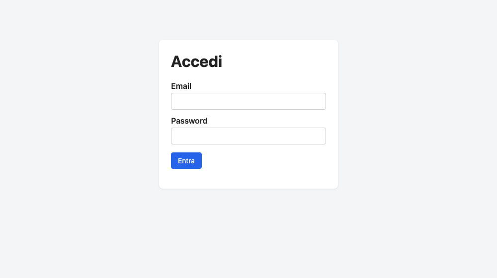 | 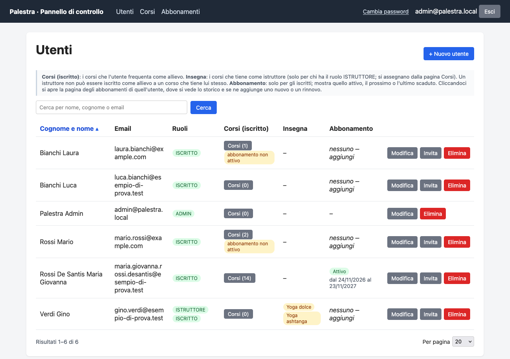 |

| Corsi con istruttore | Abbonamenti con stato |
|---|---|
| 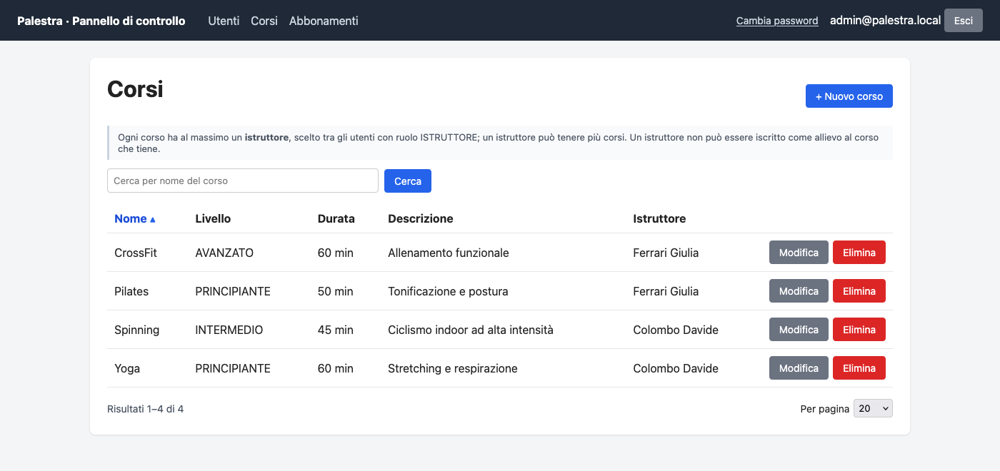 | 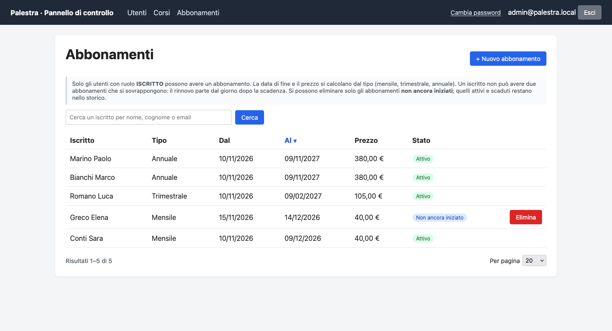 |

| Registrazione | Email di conferma |
|---|---|
| 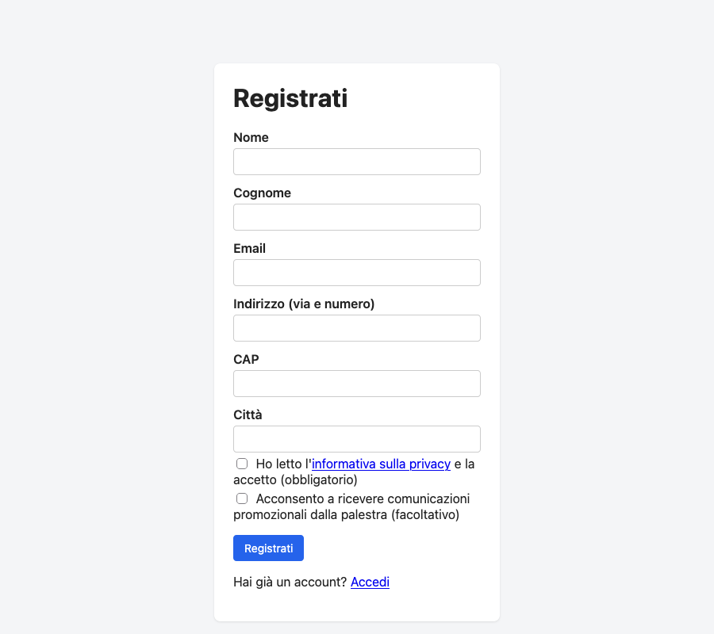 | 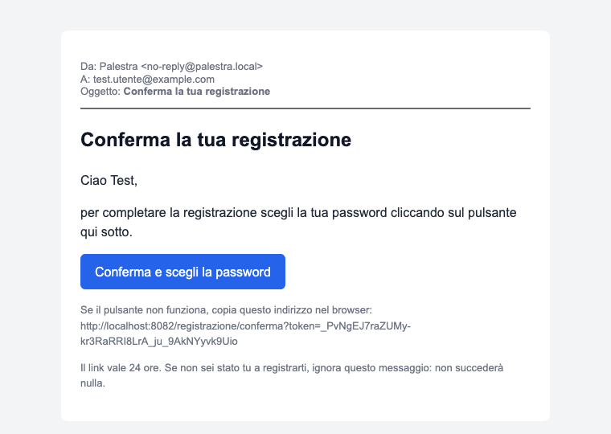 |

| Area personale di un iscritto | Area di un istruttore: i suoi corsi e gli iscritti |
|---|---|
| 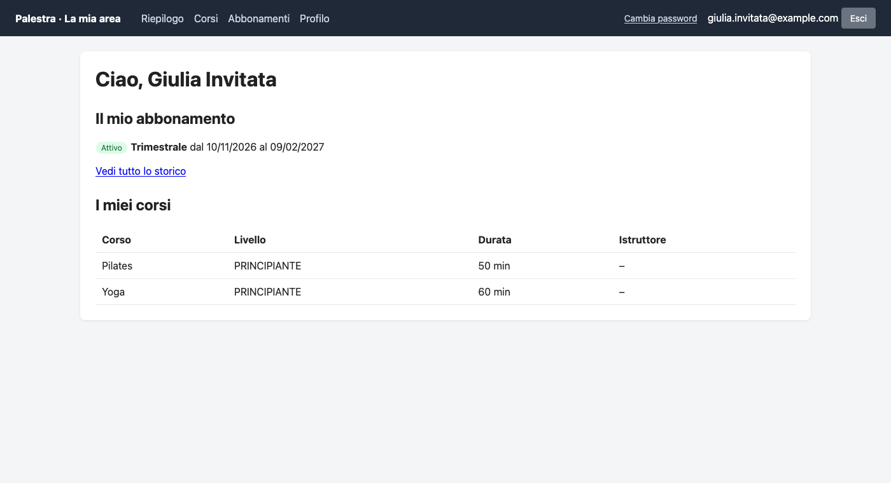 | 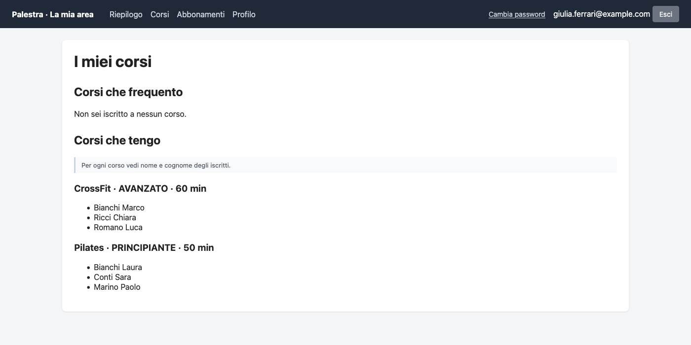 |

| Pagina «Corsi» di un utente, con la finestra di conferma | Documentazione interattiva della API (Swagger) |
|---|---|
| 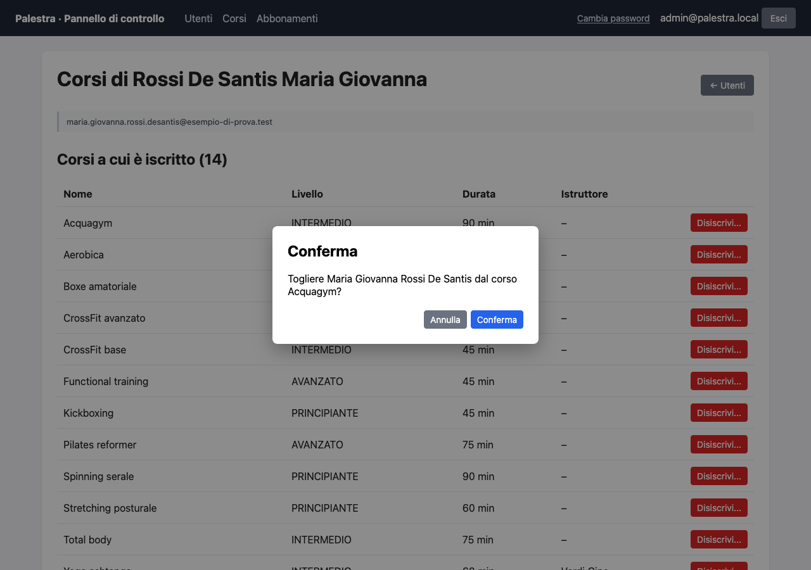 | 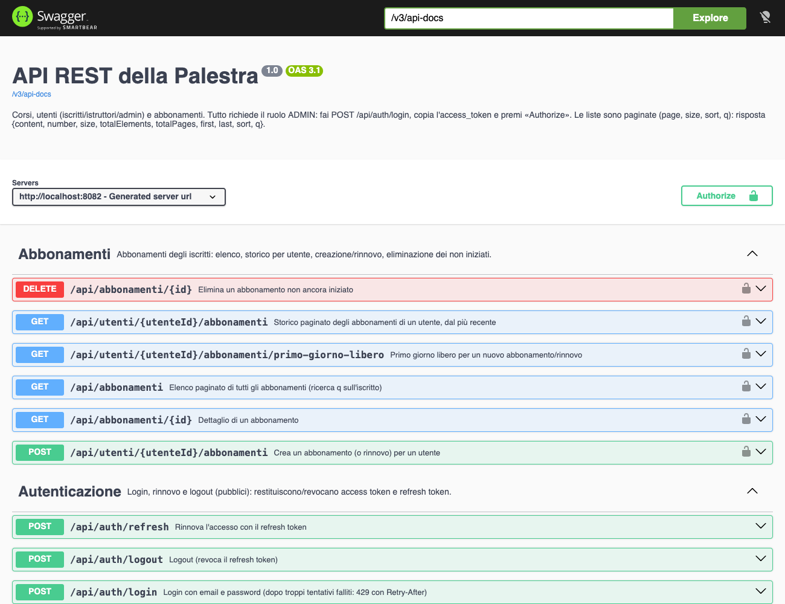 |

I dati negli screenshot sono di esempio (nomi e indirizzi inventati).

### Prova rapida con Docker

Serve solo **Docker** (Docker Desktop o Docker Engine con Compose): non servono né Java né Maven.

```bash
git clone <indirizzo-del-repository>
cd java-applicazioni/palestra
docker compose --profile app up --build
```

La prima volta Docker scarica le dipendenze e compila l'applicazione (qualche minuto); poi avvia PostgreSQL e l'app e applica da solo le migration del database, con alcuni corsi di prova.
Quando nel terminale compare `Started PalestraApplication`, apri http://localhost:8080 e accedi con `admin@palestra.local` / `admin`.

Per provare la **registrazione**: da http://localhost:8080/registrazione compila il modulo, poi apri **Mailpit** su http://localhost:8025 (l'email arriva dopo pochi secondi: la spedisce un compito programmato) (un finto server di posta incluso: l'email non esce dal tuo computer), clicca il link nell'email di conferma e scegli la password. Poi accedi dalla pagina di login: arrivi alla tua area personale.

- Si ferma con `Ctrl+C`; `docker compose --profile app down` rimuove i container, `docker compose --profile app down -v` cancella anche i dati del database.
- **Solo per provare:** la password dell'amministratore, la password del database e la chiave dei token (`JWT_SECRET`) sono valori di esempio. Per un uso vero vanno cambiati (la chiave si imposta con la variabile d'ambiente `JWT_SECRET`, lunga e casuale).
- Se la porta 8080, la 5432, la 8025 o la 1025 sono già occupate, ferma ciò che le usa oppure cambia la parte a sinistra in `compose.yaml` (`"8080:8080"`, `"5432:5432"`, `"8025:8025"`, `"1025:1025"`). Se cambi la porta dell'app cambia anche `APP_URL_PUBBLICO` nello stesso file: è l'indirizzo che finisce nei link delle email.

<details>
<summary><strong>Guida passo passo con Docker</strong> (anche se non lo hai mai usato, o se hai già qualcosa sulle porte 8080 e 5432)</summary>

Questa guida avvia una copia **separata** dell'applicazione e del suo database, su porte diverse (app su **8082**, database su **5433**, Mailpit su **8026**), con container e dati propri: non tocca niente di ciò che hai già in esecuzione.

1. **Accendi Docker Desktop** e aspetta che in basso a sinistra compaia «Engine running» (verde). Finché non lo è, i comandi danno errore.
2. **Apri un terminale nella cartella `palestra/`** del progetto e controlla di essere nel posto giusto: `ls` deve mostrare `compose.yaml`, `Dockerfile` e `pom.xml`.
3. **Crea il file che sposta le porte** (non stampa niente; su Windows crealo come file di testo nella cartella `palestra/` e usa il suo percorso nel passo 4):
   ```bash
   cat > /tmp/override-prova.yaml <<'EOF'
   services:
     db:
       container_name: palestra-db-prova
       ports: !override ["5433:5432"]
     mailpit:
       container_name: palestra-mailpit-prova
       ports: !override ["8026:8025", "1026:1025"]
     app:
       ports: !override ["8082:8080"]
       environment:
         APP_URL_PUBBLICO: http://localhost:8082
   EOF
   ```
4. **Avvia tutto**:
   ```bash
   docker compose -p palestraprova -f compose.yaml -f /tmp/override-prova.yaml --profile app up --build
   ```
   La prima volta ci vogliono alcuni minuti (scarica e compila; vedrai scorrere molto testo, è normale). Il terminale resta occupato finché l'app gira: non chiuderlo. L'app è pronta quando compare **`Started PalestraApplication in ... seconds`**.
5. **Prova nel browser** http://localhost:8082:
   - ti manda alla pagina di login; accedi con `admin@palestra.local` / `admin`;
   - in «Corsi» devi vedere 4 corsi di prova (Yoga, Spinning, CrossFit, Pilates);
   - crea, modifica ed elimina un utente;
   - da http://localhost:8082/registrazione registrati con un tuo indirizzo (anche inventato) e leggi l'email su **Mailpit**, http://localhost:8026 (arriva dopo pochi secondi): clicca il link, scegli la password e accedi alla tua area;
   - la documentazione della API è su http://localhost:8082/swagger-ui.html (serve essere loggati).
6. **Prova la API da terminale** (apri un secondo terminale, perché il primo è occupato):
   ```bash
   curl -s -X POST http://localhost:8082/api/auth/login -H 'Content-Type: application/json' \
        -d '{"email":"admin@palestra.local","password":"admin"}'
   ```
   Deve rispondere con un testo che contiene `access_token` e `refresh_token`.
7. **Verifica che i dati restino**: crea un utente senza eliminarlo, premi `Ctrl+C` nel primo terminale (l'app si ferma), rilancia il comando del passo 4 (ora parte in pochi secondi) e rifai il login: l'utente deve esserci ancora.
8. **Spegni e pulisci tutto**: `Ctrl+C` nel primo terminale, poi
   ```bash
   docker compose -p palestraprova -f compose.yaml -f /tmp/override-prova.yaml --profile app down -v --rmi local
   ```
   Cancella container, dati e immagine di questa prova. Con `docker ps -a` non deve restare nulla che contenga `prova`.

Se qualcosa non va:

| Cosa vedi | Cosa significa | Cosa fare |
|---|---|---|
| `Cannot connect to the Docker daemon` | Docker Desktop è spento | passo 1 |
| `no configuration file provided` | sei nella cartella sbagliata | passo 2 |
| `port is already allocated` / `address already in use` | la porta 8082, 5433, 8026 o 1026 è occupata | chiudi ciò che la usa (`lsof -i :8082`) |
| il link nell'email non si apre | l'indirizzo del link non è quello con cui apri il sito | controlla `APP_URL_PUBBLICO` (passo 3: deve essere `http://localhost:8082`) |
| «Credenziali non valide» al login | password sbagliata | su questa copia è `admin` |
| la pagina non si apre | l'app non ha ancora finito di partire | aspetta la riga `Started PalestraApplication` |

</details>

### Avvio per lo sviluppo

Requisiti: Java 21 e Docker Desktop.

```bash
cd palestra
docker compose up -d      # avvia PostgreSQL (database/utente/password: palestra, porta 5432) e Mailpit (email su http://localhost:8025)
./mvnw spring-boot:run    # avvia l'app
```

Poi apri http://localhost:8080 — utente iniziale `admin@palestra.local`, password `admin` (si cambia dal pannello, «Cambia password»).
Le email dell'applicazione (conferma registrazione, password dimenticata, invito, iscrizione a un corso) si leggono su http://localhost:8025. Per fermare database e Mailpit: `docker compose stop`.

### Indirizzi utili

| Cosa | Indirizzo |
|---|---|
| Pannello di amministrazione | http://localhost:8080 |
| Registrazione / area personale | http://localhost:8080/registrazione · http://localhost:8080/area |
| Email in sviluppo (Mailpit) | http://localhost:8025 |
| Swagger UI (serve il login admin nel browser) | http://localhost:8080/swagger-ui.html |
| Descrizione OpenAPI (JSON) | http://localhost:8080/v3/api-docs |
| Guida alla API (curl, Postman, errori 401/403) | [`palestra/API.md`](palestra/API.md) |
| Collection Postman | [`palestra/postman/`](palestra/postman/) |

### Test

```bash
cd palestra
./mvnw test
```

Quasi tutti i test non richiedono né Docker né PostgreSQL: usano H2 in memoria (profilo `test`, Flyway spento). Fanno eccezione `UltimoAdminConcorrenzaTest` (la regola «non si toglie l'ultimo amministratore»), `IscrizioneConcorrenzaTest` (l'iscrizione a un corso) e `CodaEmailConcorrenzaTest` (due lavoratori della coda delle email), che provano la concorrenza con due richieste simultanee su un PostgreSQL vero avviato da Testcontainers: serve Docker acceso, altrimenti quei test vengono saltati. Un test solo: `./mvnw test -Dtest=NomeClasse#nomeMetodo`.

### Configurazione

Le impostazioni stanno in `palestra/src/main/resources/application.properties`. In produzione vanno impostate, tra le altre, queste variabili d'ambiente:

| Variabile | A cosa serve |
|---|---|
| `JWT_SECRET` | chiave di firma dei token JWT (almeno 32 caratteri) |
| `DB_USER`, `DB_PASSWORD` | accesso al database |
| `APP_URL_PUBBLICO` | indirizzo pubblico del sito, usato nei link delle email (mai ricavato dalla richiesta) |
| `SPRING_MAIL_HOST`, `SPRING_MAIL_PORT`, `SPRING_MAIL_USERNAME`, `SPRING_MAIL_PASSWORD` | server SMTP con cui spedire le email (in sviluppo Mailpit su `localhost:1025`) |
| `APP_EMAIL_CODA_ATTIVA=false` | spegne la coda delle email: l'email parte subito dentro la richiesta, come prima della coda (predefinito: acceso) |
| `SPRINGDOC_ENABLED=false` | spegne Swagger |

### Struttura del codice (`palestra/src/main/java/it/palestra`)

| Cartella | Contenuto |
|---|---|
| `web/` | controller delle pagine HTML e relativi moduli (form) |
| `api/` e `api/dto/` | controller REST e oggetti di richiesta/risposta JSON |
| `service/` | logica di business (le regole stanno qui, scritte una volta sola); riceve i dati come semplici record (`Dati*`) e non conosce né le pagine né la API |
| `repository/` | accesso al database (Spring Data JPA) |
| `model/` | entità JPA |
| `pagina/` | paginazione, ordinamento e ricerca delle liste |
| `config/` | sicurezza, JWT, Swagger, cache, orologio, compiti programmati |
| `exception/` | eccezioni di dominio |

Ogni livello dipende solo da quelli più interni (`web`, `api` → `service` → `repository` → `model`): un test (`DipendenzeTraLivelliTest`) fallisce se un `service` importa classi di `web` o `api`.

Le migration del database sono in `palestra/src/main/resources/db/migration` (una migration già applicata non si modifica: se ne crea una nuova).

### Modello dei dati

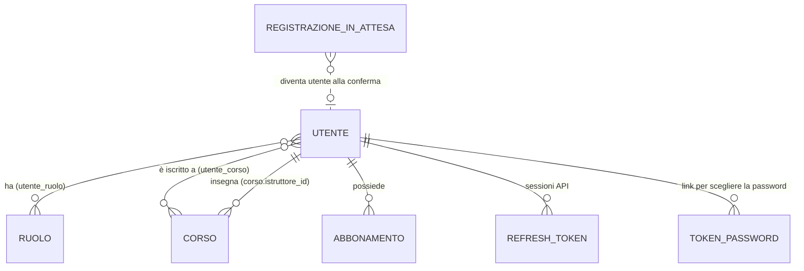

Non ci sono tabelle separate per iscritti e istruttori: sono **ruoli** di un'unica entità `Utente` (`ADMIN`, `ISTRUTTORE`, `ISCRITTO`; un utente può averne più d'uno).
Può fare login chi ha una password, qualunque ruolo abbia: l'amministratore va al pannello, iscritti e istruttori alla propria area personale. Una scheda creata dall'amministratore senza password può essere attivata con un invito via email o dalla «password dimenticata». Chi si registra da solo non è un utente finché non conferma l'email: fino ad allora i suoi dati stanno in `registrazione_in_attesa`.

### Regole di business

Le regole vivono nei `service/` e valgono sia per le pagine sia per la API (una violazione è un riquadro rosso nella pagina e un `409` nella API). Il database ripete quelle più delicate.

**Utenti e ruoli**
- Il login è con email e password. Il pannello e la API sono riservati al ruolo `ADMIN`; l'area personale (`/area`) ai ruoli `ISCRITTO` e `ISTRUTTORE`.
- Non si può eliminare né declassare l'ultimo admin.
- Un utente con abbonamenti non si elimina e non perde il ruolo `ISCRITTO`.

**Area personale**
- Ognuno vede **solo i propri dati**: la persona si ricava sempre dal login, mai da un numero scritto nell'indirizzo (nessuna pagina accetta l'id di un altro utente).
- L'istruttore vede, per ciascun corso che tiene, nome e cognome degli iscritti: niente email, niente abbonamenti. Ognuno può dare o ritirare il consenso (facoltativo) alle comunicazioni promozionali.

**Registrazione, password dimenticata e inviti**
- Il modulo chiede nome, cognome, email, indirizzo di casa (via, CAP, città) e l'accettazione **obbligatoria** dell'informativa sulla privacy; il consenso alle comunicazioni promozionali è una casella facoltativa e separata. La versione dell'informativa accettata e la data si salvano con l'utente. Il testo in `/privacy` è di esempio: va sostituito prima di un uso reale.
- Nessun account viene creato prima della conferma: i dati restano in una tabella di registrazioni **in attesa** (una sola per indirizzo; un nuovo invio la sostituisce e il vecchio link smette di valere; tra due email alla stessa persona passano almeno 2 minuti, ma se la persona rimanda il modulo subito dopo per correggere un dato, i dati si aggiornano comunque e l'account nasce con quelli dell'ultimo invio). Chi sbaglia l'indirizzo non blocca nessuno: la riga scade da sola. Il link vale 24 ore, si usa **una sola volta** e aprirlo non lo consuma; la password si sceglie dopo averlo aperto.
- La risposta del sito è **sempre la stessa**, che l'email sia registrata o no (nessuno può scoprire chi è iscritto). Se l'indirizzo ha già un account con password arriva un avviso «hai già un account»; se esiste una scheda creata dall'amministratore senza password, la registrazione la **attiva** senza cambiare nome, cognome, corsi e abbonamenti già registrati.
- «Password dimenticata»: link valido 1 ora e monouso; scegliere la nuova password revoca i token della API. L'amministratore può **invitare** dal pannello chi non ha una password (link valido 24 ore).
- Difese: limite alle richieste di email (per indirizzo+email e per indirizzo), campo trappola per i programmi automatici, token casuali di cui nel database c'è solo l'hash, link costruiti con l'indirizzo configurato (non con quello della richiesta), `Referrer-Policy: no-referrer` sulle pagine con il token. I link scaduti si cancellano ogni notte.

**Iscrizione ai corsi e abbonamento**
- Per **aggiungere** un corso a **qualunque** utente serve un abbonamento **attivo oggi** (primo e ultimo giorno inclusi; uno futuro o scaduto non basta). Vale nella pagina «Corsi» del pannello e nella API; creare un utente già con dei corsi è rifiutato, perché non può avere ancora un abbonamento (prima si crea, poi si aggiunge l'abbonamento, poi si scelgono i corsi). Gli abbonamenti si possono avere solo con il ruolo `ISCRITTO`: chi non lo ha (per esempio un istruttore) non si iscrive a un corso finché non gli si assegnano il ruolo e un abbonamento.
- I corsi già assegnati **restano** anche se l'abbonamento scade o manca: compare solo un avviso («abbonamento non attivo») nella lista utenti, nella pagina «Corsi» dell'utente e nell'area personale dell'iscritto. Togliere corsi si può sempre; per aggiungerne altri bisogna rinnovare.

**Corsi e istruttori**
- Un corso ha al massimo **un** istruttore; un istruttore può tenere **più** corsi. L'istruttore deve avere il ruolo `ISTRUTTORE`.
- L'istruttore non può essere iscritto come allievo al corso che tiene (controllo in nomina e in iscrizione).
- Finché tiene corsi, un utente non può perdere il ruolo `ISTRUTTORE` né essere eliminato. Un corso con iscritti non si elimina.

**Abbonamenti**
- Solo gli utenti `ISCRITTO` possono averne. Tipi e listino: mensile (1 mese, 40 €), trimestrale (3 mesi, 105 €), annuale (12 mesi, 380 €).
- La data di fine e il prezzo si **calcolano** dal tipo (fine = inizio + durata − 1 giorno); il prezzo di listino viene copiato sull'abbonamento e non cambia se il listino cambia.
- Lo stato (futuro / attivo / scaduto) non è salvato: si calcola dalle date rispetto a oggi.
- La data di inizio non può essere nel passato; per lo stesso iscritto **non ci sono sovrapposizioni** (un rinnovo parte il giorno dopo la fine). Si eliminano solo gli abbonamenti non ancora iniziati.

### Architettura in breve

```
Browser ──► web/ (Thymeleaf, sessione + CSRF) ─┐
                                               ├─► service/ (regole) ─► repository/ (JPA) ─► PostgreSQL
Client API ─► api/ (JSON, JWT stateless)      ─┘
```

- **Due catene di sicurezza** (`config/SecurityConfig`): `/api/**` è stateless, senza CSRF, con JWT; tutto il resto è il pannello con sessione e CSRF.
- **Token API:** `POST /api/auth/login` restituisce `access_token` (JWT, 60 minuti) e `refresh_token` (stringa casuale, 7 giorni, nel database solo l'hash). Ogni rinnovo ruota il refresh token; il riuso di uno già usato revoca tutte le sessioni dell'utente.
  Gli access token si possono **revocare prima della scadenza** (logout, cambio di password o ruoli, sospetto furto): ognuno porta la «versione» dei token dell'utente e a ogni richiesta si confronta con quella nel database. Ogni notte si cancellano i refresh token scaduti.
- **Coda delle email** (`service/InvioEmailInCoda`, `SpedizioneEmailProgrammata`, tabella `email_in_coda`): `NotificheEmail` chiama `InvioEmail` come sempre, ma l'implementazione usata scrive solo una riga; ogni 5 secondi un compito programmato prende un gruppo di righe, le «reclama» con un `UPDATE` condizionato (così più istanze dell'app non spediscono mai la stessa email due volte), le spedisce fuori da ogni transazione e cancella la riga; se l'invio fallisce riprova dopo 1, 2, 4... minuti (massimo 5 tentativi, poi `FALLITA`; la pulizia notturna cancella le fallite dopo 24 ore perché contengono il link con il token). Garanzia: ogni email parte **almeno** una volta (se l'app si ferma a metà può arrivarne una doppia). L'SMTP ha dei timeout (5 s per collegarsi, 10 per rispondere). `app.email.coda.attiva=false` ripristina l'invio immediato.
- **Limite ai tentativi di login** (API e pannello): 5 errori per coppia indirizzo+email e 20 per indirizzo in 15 minuti, poi `429` con `Retry-After` (o `/login?bloccato` nel pannello).
- **DTO:** la API non espone mai le entità, ma record dedicati (`api/dto`).
- **Errori:** `400` dati o parametri non validi (con il dettaglio per campo), `401`/`403` autenticazione e ruolo, `404` risorsa inesistente, `409` regola di business violata. Il motivo di un `401`/`403` si legge nel log dell'app, non nella risposta.
- **Liste paginate** (pagine e API): parametri `page` (da 0), `size` (1–100, default 20), `sort` (`campo,asc|desc`, solo campi ammessi) e `q` (ricerca testuale). Parametri sbagliati danno `400`. Le risposte JSON hanno la forma `{content, number, size, totalElements, totalPages, first, last, sort, q}`.
- **Orologio:** la data di oggi viene da un `Clock` iniettato, mai da `LocalDate.now()`, così i test possono fissarla.
- **Cache:** una sola, per l'elenco dei ruoli (Caffeine in memoria).
- **Database:** schema gestito da Flyway; Hibernate lo controlla soltanto (`ddl-auto=validate`). La ricerca di testo sugli utenti usa indici trigram (PostgreSQL `pg_trgm`): con 100.000 utenti risponde in pochi millisecondi.

### Test automatici (CI)

A ogni push e a ogni pull request GitHub Actions ([`.github/workflows/test.yml`](.github/workflows/test.yml)) scarica il codice, installa Java 21 e lancia `./mvnw test` su un computer pulito: l'etichetta «Test» in cima a questa pagina diventa verde se tutti i test passano.

### Nota

**Solo codice dimostrativo.** Il progetto è pubblicato per essere guardato e provato, non per essere riutilizzato: i dati di esempio, le password iniziali e il testo dell'informativa sulla privacy sono segnaposto.
