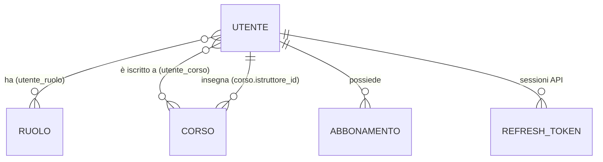

# java-applicazioni

Raccolta di applicazioni Java di Alessandro (monorepo privato). Oggi contiene una sola applicazione:

| Cartella | Cosa è |
|---|---|
| [`palestra/`](palestra/) | **Gestione Palestra**: pannello di controllo web + API REST per corsi, utenti (admin, istruttori, iscritti) e abbonamenti |

## Gestione Palestra

**Stack:** Java 21 (Temurin) · Spring Boot 4.1 · Maven · Thymeleaf · Spring Security (sessione per il pannello, JWT per la API) · JPA/Hibernate · PostgreSQL 17 (Docker) + Flyway · Swagger/OpenAPI (springdoc) · JUnit + MockMvc.

**Cosa fa**
- Login nel pannello (solo ruolo ADMIN) e CRUD di corsi, utenti e abbonamenti, con liste paginate, ordinabili e con ricerca.
- Istruttori (uno-a-molti verso i corsi) e iscritti (molti-a-molti), con regole di business (es. un istruttore non può iscriversi al proprio corso; abbonamenti senza sovrapposizioni).
- API REST sotto `/api` con JWT + refresh token (formato OAuth2) e documentazione Swagger.

### Avvio

Requisiti: Java 21 e Docker Desktop.

```bash
cd palestra
docker compose up -d      # avvia PostgreSQL (database/utente/password: palestra, porta 5432)
./mvnw spring-boot:run    # avvia l'app
```

Poi apri http://localhost:8080 — utente iniziale `admin@palestra.local`, password `admin` (si cambia dal pannello, «Cambia password»).
Per fermare il database: `docker compose stop`.

### Indirizzi utili

| Cosa | Indirizzo |
|---|---|
| Pannello | http://localhost:8080 |
| Swagger UI (serve il login admin nel browser) | http://localhost:8080/swagger-ui.html |
| Descrizione OpenAPI (JSON) | http://localhost:8080/v3/api-docs |
| Guida alla API (curl, Postman, errori 401/403) | [`palestra/API.md`](palestra/API.md) |
| Collection Postman | [`palestra/postman/`](palestra/postman/) |

### Test

```bash
cd palestra
./mvnw test
```

Non servono Docker né PostgreSQL: i test usano H2 in memoria (profilo `test`, Flyway spento). Un test solo: `./mvnw test -Dtest=NomeClasse#nomeMetodo`.

### Configurazione

Le impostazioni stanno in `palestra/src/main/resources/application.properties`. In produzione vanno impostate, tra le altre, queste variabili d'ambiente:

| Variabile | A cosa serve |
|---|---|
| `JWT_SECRET` | chiave di firma dei token JWT (almeno 32 caratteri) |
| `DB_USER`, `DB_PASSWORD` | accesso al database |
| `SPRINGDOC_ENABLED=false` | spegne Swagger |

### Struttura del codice (`palestra/src/main/java/it/palestra`)

| Cartella | Contenuto |
|---|---|
| `web/` | controller delle pagine HTML (come i controller Laravel) |
| `api/` e `api/dto/` | controller REST e oggetti di richiesta/risposta JSON |
| `service/` | logica di business (le regole stanno qui, scritte una volta sola) |
| `repository/` | accesso al database (Spring Data, come Eloquent) |
| `model/` | entità JPA |
| `pagina/` | paginazione, ordinamento e ricerca delle liste |
| `config/` | sicurezza, JWT, Swagger, cache, orologio |
| `exception/` | eccezioni di dominio |

Le migration del database sono in `palestra/src/main/resources/db/migration` (una migration già applicata non si modifica: se ne crea una nuova).

### Modello dei dati



Non ci sono tabelle separate per iscritti e istruttori: sono **ruoli** di un'unica entità `Utente` (`ADMIN`, `ISTRUTTORE`, `ISCRITTO`; un utente può averne più d'uno).
Solo chi ha una password può fare login (oggi gli admin); iscritti e istruttori sono anagrafiche gestite dal pannello.

### Regole di business

Le regole vivono nei `service/` e valgono sia per le pagine sia per la API (una violazione è un riquadro rosso nella pagina e un `409` nella API). Il database ripete quelle più delicate.

**Utenti e ruoli**
- Il login è con email e password. Il pannello e la API sono riservati al ruolo `ADMIN`.
- Non si può eliminare né declassare l'ultimo admin.
- Un utente con abbonamenti non si elimina e non perde il ruolo `ISCRITTO`.

**Corsi e istruttori**
- Un corso ha al massimo **un** istruttore; un istruttore può tenere **più** corsi. L'istruttore deve avere il ruolo `ISTRUTTORE`.
- L'istruttore non può essere iscritto come allievo al corso che tiene (controllo in nomina e in iscrizione).
- Finché tiene corsi, un utente non può perdere il ruolo `ISTRUTTORE` né essere eliminato. Un corso con iscritti non si elimina.

**Abbonamenti**
- Solo gli utenti `ISCRITTO` possono averne. Tipi e listino: mensile (1 mese, 40 €), trimestrale (3 mesi, 105 €), annuale (12 mesi, 380 €).
- La data di fine e il prezzo si **calcolano** dal tipo (fine = inizio + durata − 1 giorno); il prezzo di listino viene copiato sull'abbonamento e non cambia se il listino cambia.
- Lo stato (futuro / attivo / scaduto) non è salvato: si calcola dalle date rispetto a oggi.
- La data di inizio non può essere nel passato; per lo stesso iscritto **non ci sono sovrapposizioni** (un rinnovo parte il giorno dopo la fine). Si eliminano solo gli abbonamenti non ancora iniziati.

### Architettura in breve

```
Browser ──► web/ (Thymeleaf, sessione + CSRF) ─┐
                                               ├─► service/ (regole) ─► repository/ (JPA) ─► PostgreSQL
Client API ─► api/ (JSON, JWT stateless)      ─┘
```

- **Due catene di sicurezza** (`config/SecurityConfig`): `/api/**` è stateless, senza CSRF, con JWT; tutto il resto è il pannello con sessione e CSRF.
- **Token API:** `POST /api/auth/login` restituisce `access_token` (JWT, 60 minuti) e `refresh_token` (stringa casuale, 7 giorni, nel database solo l'hash). Ogni rinnovo ruota il refresh token; il riuso di uno già usato revoca tutte le sessioni dell'utente.
- **DTO:** la API non espone mai le entità, ma record dedicati (`api/dto`).
- **Errori:** `400` dati o parametri non validi (con il dettaglio per campo), `401`/`403` autenticazione e ruolo, `404` risorsa inesistente, `409` regola di business violata. Il motivo di un `401`/`403` si legge nel log dell'app, non nella risposta.
- **Liste paginate** (pagine e API): parametri `page` (da 0), `size` (1–100, default 20), `sort` (`campo,asc|desc`, solo campi ammessi) e `q` (ricerca testuale). Parametri sbagliati danno `400`. Le risposte JSON hanno la forma `{content, number, size, totalElements, totalPages, first, last, sort, q}`.
- **Orologio:** la data di oggi viene da un `Clock` iniettato, mai da `LocalDate.now()`, così i test possono fissarla.
- **Cache:** una sola, per l'elenco dei ruoli (Caffeine in memoria).
- **Database:** schema gestito da Flyway; Hibernate lo controlla soltanto (`ddl-auto=validate`).

### Note di lavoro

[`CLAUDE.md`](CLAUDE.md) contiene lo stato del progetto, le regole di lavoro e l'elenco dei punti ancora da fare.
